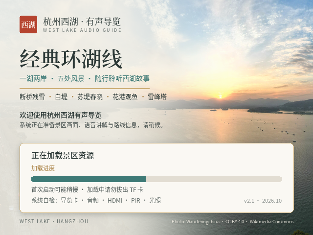
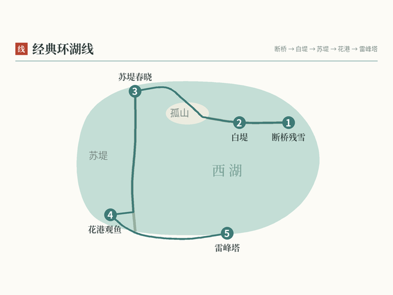
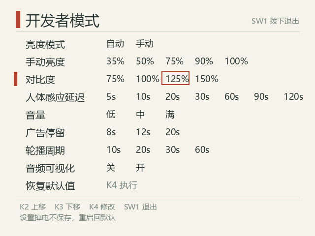
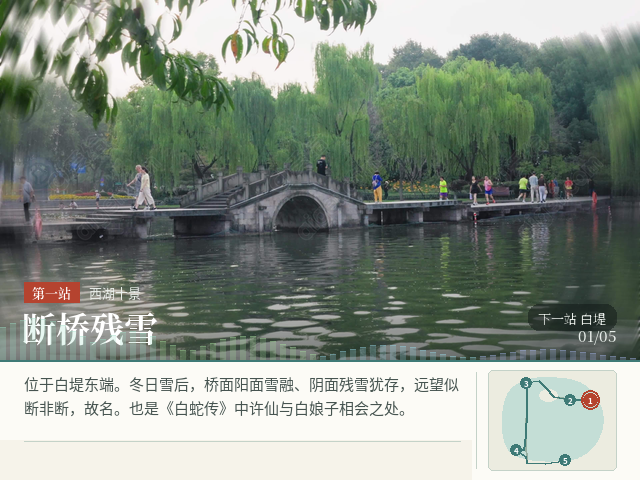

# 西湖有声导览 · FPGA 语音导览与数字广告终端

基于 **安路 EG4S20BG256** 的裸机（无操作系统）声画导览终端：HDMI 640×480@60 输出，单颗 SDRAM 作帧缓存，SD 卡（FAT32）存放景区卡片与 48 kHz PCM 讲解，带同步字幕、广告平移动画、人体感应、环境光自适应亮度、开发者模式与全屏音频频谱。



## 功能

- **声画导览**：路线图 + 五处景点语音讲解，字幕与语音共用采样级时间轴（0.25 s 一格，暂停/重播不漂移）
- **交互**：自动轮播、整屏放大（KEY3 长按）、暂停/重播、紧急播报（KEY4 长按）
- **数字广告**：7→8→9 水平平移切换（32 步，约 0.55 s），广告页无音轨
- **人体感应**：HC-SR501 检测无人 → 讲解结束后自动进广告；有人立即回导览
- **环境光自适应**：BH1750 六档数字调光，1.2× 迟滞、每帧 ±2 渐变，紧急播报强制 100%
- **开机画面**：先装一张开机卡，带真实加载进度（进度条由 FPGA 叠加）
- **开发者模式**：SW1 进入 + 三个按键操作，9 项参数现场可调（亮度模式/手动亮度、对比度、感应延迟、音量、广告停留、轮播周期、频谱开关），每行下划线标出当前值
- **音频频谱**：8 段一阶滤波器组驱动 64 根半透明短柱，贴在照片与标签的交界线上，不挡文字

| 导览页 | 开发者模式 | 频谱 |
|---|---|---|
|  |  |  |

## 硬件

| 项 | 说明 |
|---|---|
| FPGA | 安路 EG4S20BG256（康芯 HX4S20 板） |
| 显示 | HDMI 640×480@60（像素时钟 25 MHz，TMDS 250 Mbps） |
| 存储 | 板载 SDRAM 2M×32（8 MB）+ TF 卡（FAT32） |
| 音频 | HDMI 内嵌音频，48 kHz / 16 bit / 单声道 PCM |
| 光感 | GY-302（BH1750），I2C 100 kHz，J1：SCL D14 / SDA G11 |
| 人体 | HC-SR501，J2：OUT N1（可重复触发） |
| 拨码/按键 | SW1 开发者模式、SW2 预留、SW3 静音、SW4 强制无人；KEY1 复位，KEY2/3/4 操作 |

## 架构

```
SD 卡 ──FAT32──► FAT 流 ──► SDRAM 帧缓存（12 页 × 153,600 字）
                              │ 行缓冲 ×4 bank（双页 × 奇偶）
                              ▼
     卡片/开机卡/广告 ──► 视频流水线 ──► 字幕 OSD ──► 频谱/设置页叠加 ──► 亮度/对比度 ──► HDMI
                              ▲
讲解 PCM ──► 音频 FIFO ──► HDMI 音频（ACR 校准）
```

- **单 SDRAM 时分复用**：装载写与显示读按 4 字一组轮流，写入只占行读（320 字）之间的空隙，解决"边显示边装载"的带宽冲突；
- **字幕 OSD**：预生成 16×16 2bit 字库 ROM + 文本 ROM 两级查表，2 拍出像素；
- **调光/对比度**：亮度乘 0..256，对比度以 128 为轴纯移位实现（0.75/1.0/1.25/1.5），100% 时逐像素不变。

## 构建

需要 TangDynasty 6.2.1（TD）与 Python 3（Pillow）。在仓库根目录：

```powershell
python -X utf8 scripts\generate_project_640.py
powershell -NoProfile -ExecutionPolicy Bypass -File scripts\td-build.ps1 build\syn_640 -LogDir .\logs
powershell -NoProfile -ExecutionPolicy Bypass -File scripts\td-build.ps1 build\phy_640 -LogDir .\logs -FlowScript <仓库绝对路径>\scripts\flow_seed2.tcl
```

> **必须带 `-FlowScript ...\flow_seed2.tcl`（place seed=2）**：默认 seed 的布局会让 TD 6.2.1 在 *Stage 3 | Hold Fix* 对 HDMI 核内 reset 网插 hold buffer 时 coredump（工具 bug）。

产物：`build/phy_640/westlake_guide_top_640.bit`（659,907 B）。

## 测试

```powershell
python -X utf8 scripts\run_tests.py
```

17 项 Icarus 回归：FAT 流、BMP 解析、音频/静音、按键、媒体装载、广告、紧急、BH1750、亮度、开发者菜单、频谱、整帧像素（640×480 逐像素）、缩放、平移。

## 上卡

```powershell
powershell -NoProfile -ExecutionPolicy Bypass -File scripts\deploy_card.ps1 E:
```

卡上 19 个文件：`PIC00..PIC11.DAT`（640×480 裸 RGB565，各 614,400 B）+ `AUD00..06.PCM`。

## 资源与时序（最近构建）

| 项 | 值 |
|---|---|
| LUT | 8,602 / 19,600（43.89%） |
| 寄存器 | 4,794 |
| 9Kb RAM | 59 / 64 |
| DSP | 13 / 29 |
| Setup / Hold WNS | +1435 ps / +3 ps，0 违例 |

## 目录

```
rtl/            全部自研 RTL（视频、字幕、媒体、按键、广告、紧急、传感器、开发者模式、频谱）
sim/            21 个 testbench
scripts/        工程生成、字库/卡生成、测试、上卡校验、TD 构建脚本
constraints/    引脚与时序约束
vendor/         板卡厂商提供的加密核（HDMI / SDRAM / PLL）
assets/         截图
release/        最终比特流 + 上机速读
```

## 说明

- 素材（照片/讲解音频/卡片 .DAT）不在仓库内，需另行准备；`card/` 与 `westlake_guide_v4/` 在本地工程中；
- `vendor/` 为板卡厂商例程中的加密核，仅供本工程构建使用；
- 布局布线务必使用 `flow_seed2.tcl`；
- 按键/拨码/接线细节见 `release/上机速读_v24_对比度.txt`。
